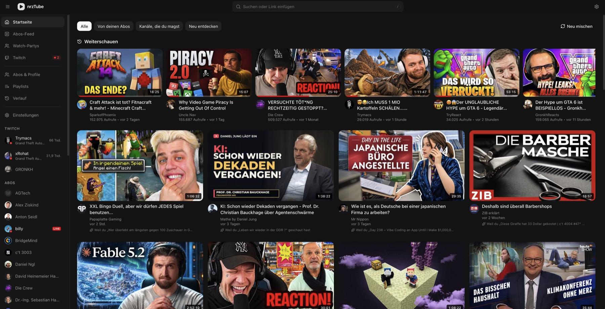
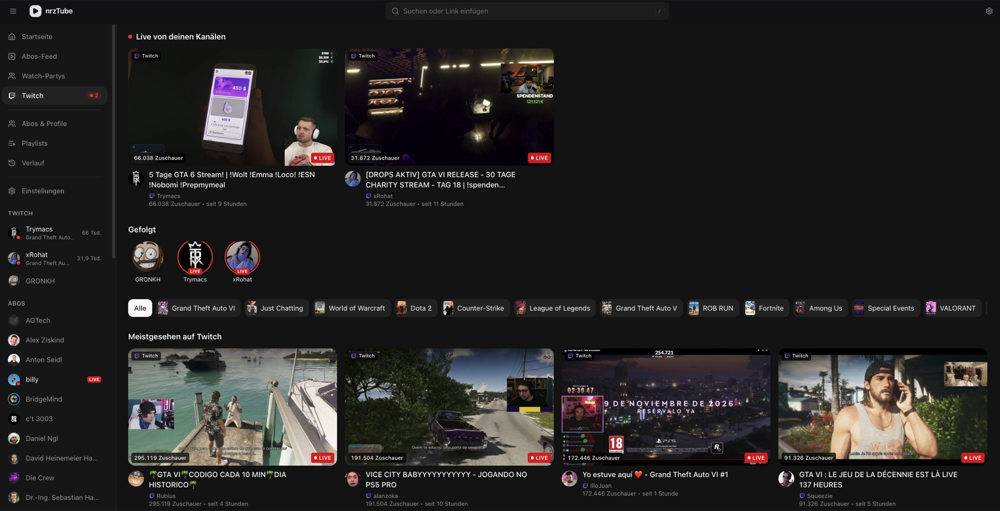

<div align="center">

# ▶ nrzTube

**YouTube and Twitch without ads or tracking – with your own subscriptions, recommendations, watch parties and live chat.**

A private, self-hosted frontend written in Rust, inspired by [Invidious](https://github.com/iv-org/invidious) and FreeTube.
The server fetches everything itself – your browser never talks to Google or Twitch.


**Deutsch** — Privates YouTube- und Twitch-Frontend in Rust, ohne Werbung und ohne Tracking.<br>
**Español** — Frontend privado de YouTube y Twitch escrito en Rust, sin anuncios ni rastreo.

</div>



<p align="center"><sub>Home – continue watching, recommendations with a reason, subscriptions and live channels in the sidebar</sub></p>



<p align="center"><sub>Twitch – live from your channels, followed streamers, categories and the most watched streams, ad-free</sub></p>

---

## Contents

- [Features](#features)
- [How it works](#how-it-works)
- [Quick start](#quick-start)
- [Configuration](#configuration)
- [Development](#development)
- [umbrelOS / nrzStore](#umbrelos--nrzstore)
- [License](#license)

## Features

### 🎬 YouTube without ads
- **Custom player** with HLS up to 4K, quality, speed, subtitles and a "most replayed" graph
- **Chapters** in the timeline and as thumbnails below the video
- **Timeline preview** on hover and **hover previews** on video cards
- **Selectable audio track** – multi-language videos start in your language (default German), otherwise the original
- **Related videos instantly**, switch videos without a reload
- **SponsorBlock** – per category: skip, show a button or just highlight; queried by hash prefix
- **DeArrow** – better titles and thumbnails from the community
- **Comments, channel posts** (community posts with images, polls and videos), **trending** by region and category
- **Age-restricted videos** through a stored YouTube login (cookies.txt, used for nothing else)

### 🏠 Personal home & subscriptions
- **Recommendations with a reason** ("Because you watched …") – built from watch time, likes and subscriptions, computed locally
- Filters **All · From your subscriptions · Channels you like · Discover**, plus "Shuffle"
- **Continue watching** with progress bars
- **Local subscriptions, playlists and history** – per account, searchable
- **Profiles** group subscriptions into a focused feed
- **Watch list & stream mode** – collect videos and play them back to back, optionally without history
- **Import / export**: FreeTube, NewPipe, Invidious, YouTube Takeout (CSV), OPML

### 🟣 Twitch
- **Ad-free livestreams** (alternative player type like vaft, otherwise ad segments are stripped)
- **VODs – including subscriber-only ones** (like TwitchNoSub), clips, categories, search
- **Live from your channels**, followed bar with live badges, most watched, category filter
- Follows, history and recommendations; hide channels and categories (like unwanted-twitch)
- **YouTube and Twitch channels of the same creator** are linked automatically – with a live badge in your subscriptions

### 💬 Live chat
- Twitch and YouTube Live: **read without an account**, write after signing in (Twitch via code, YouTube via cookies.txt)
- Emotes from **7TV, BTTV and FrankerFaceZ**
- Collapsible, resizable chat, synced to the stream

### 👥 Watch party
- Watch together via **invite link** or **publicly listed** – guests without an account welcome
- Synchronized playback, queue and chat
- **Per-participant permissions**, set by the host

### 🎙️ Can I React
- The channel's reaction guidelines right below the video ([canireact.com](https://canireact.com)): stream/video allowed, conditions, placement and TOS sections

### 📊 Recap
- Your watch time by channel, video, day and hour – with details (Settings → Recap)

### 🧰 Comfort
- **Mini player** (draggable), **picture-in-picture**, multiple windows
- **External player**: VLC, IINA, Infuse, M3U or copy the URL
- **Screenshot** with `S` or the camera icon (PNG/JPEG)
- **Keyboard shortcuts** – `?` shows them all (K/Space, J/L, F, M, T, S, I, C, P, `,`/`.`, arrow keys …)
- **Search or paste a link** – YouTube and Twitch links open directly (`/` focuses the search)

### 🛡️ Privacy & family
- **No ads, no tracking** – no Google cookies, no Google JavaScript; thumbnails, videos and subtitles go through a signed proxy
- **Family friendly**: restricted mode, hide channels and words
- **Distraction free**: hide Shorts, comments, recommendations, likes, views and more
- **Multiple accounts** – the first one becomes admin; **invite links** (single use, 7 days) even with closed registration

## How it works

```
Browser ──▶ nrzTube (axum) ──▶ YouTube InnerTube · yt-dlp · Twitch GQL/HLS
   ▲              │                SponsorBlock · DeArrow · canireact.com
   │              ▼
   └──── signed proxy (thumbnails, videos, subtitles)        SQLite (accounts, subscriptions, history)
```

| Part | Stack |
|---|---|
| **Server** | Rust, axum, SQLite, own InnerTube extractor (search, videos, channels, posts, playlists, comments, trending), yt-dlp for the streams |
| **UI** | Dioxus 0.7 (WebAssembly) with nrzUI, player with hls.js – embedded in the binary |
| **Proxy** | thumbnails, videos and subtitles signed and served through the server |
| **Recommendations** | computed locally from watch time, likes and subscriptions – nothing leaves your device |

## Quick start

```sh
docker build -f build/Dockerfile -t nrztube .
docker run -p 8455:8455 -v nrztube-data:/data nrztube
```

Open <http://localhost:8455> and create the first account – it becomes admin.
Subscribe via search or import your subscriptions under **Abos & Profile** (Subscriptions & Profiles).

## Configuration

| Variable | Default | Meaning |
|---|---|---|
| `NRZTUBE_PORT` | `8455` | port |
| `NRZTUBE_ADDRESS` | `0.0.0.0` | bind address |
| `NRZTUBE_DATA_DIR` | `data` | database and files |
| `NRZTUBE_YTDLP` | `yt-dlp` | path to yt-dlp |
| `NRZTUBE_LOG` | | log filter |
| `NRZTUBE_SECRET` | random (`data/secret`) | key for signed proxy URLs (min. 16 characters) |

## Development

```sh
build/ui.sh                   # build the UI into ui/dist/public (needs dx 0.7 and wasm32)
cargo run --release           # server on http://localhost:8455
```

```
src/        server: routes, InnerTube (yt/), Twitch, live chat, watch party, recap, recommendations
ui/         UI (Dioxus): pages, player, components
types/      types shared by server and UI
build/      Dockerfile, UI and release scripts
umbrel/     umbrelOS package
```

## umbrelOS / nrzStore

App ID `nrz-tube`, port `8455`. Package files live in `umbrel/`, managed through `nrzStore.json`.
New version: `build/umbrel-release.sh <version>` builds the binary, yt-dlp and Deno for amd64/arm64,
puts them on the `umbrel` branch and pushes the tag `umbrel-<version>` – nrzGit then updates the
store by itself.

## License

AGPL-3.0-or-later. SponsorBlock and DeArrow by Ajay Ramachandran.
